<style scoped>
    section { background-color: #33609d; }
</style>

---

# Indice

1. [UML dei package](#uml-dei-package)
2. [Separazione modello vista: Pre e Post refactoring](#separazione-modello-vista-pre-refactoring)
3. GRASP
    1. [Creator, Information Expert, Indirection](#grasp-creator-information-expert-indirection)
4. SOLID
    1. [Open-Closed Principle](#solid-open-closed-principle-pre-refactoring)
5. GoF
    1. [Strategy](#gof-strategy-pre-e-post-refactoring)
    2. [Repository](#gof-repository)
6. [Testing](#testing)
7. [Refactoring](#refactoring)

<style scoped>
    ol, li, ul { font-size: 0.9rem; }
</style>

---

# UML dei package
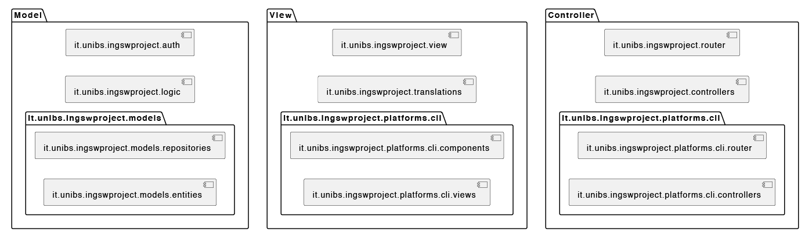

---

# Separazione modello vista: Pre refactoring

`CliPage` e le sottoclassi includevano sia responsabilità del controller (es. gestione autorizzazioni, gestione comandi) sia della view (renderizzazione), violando pertanto il pattern MVC.

1. **Accoppamento elevato**: `CliPage` molto accoppiata perché gestisce più responsabilità (diverse tra loro).
2. **Coesione bassa**: Classi con responsabilità miste. 
3. **Routing di pagine gestito nella View**: Navigazione tra pagine gestita direttamente nelle view, che creavano manualmente la nuova pagina e le passavano il controllo => accoppiamento elevato.
4. **Conseguente difficoltà di testare separatamente UI e logica di persistenza**.

---

# Separazione modello vista: Post refactoring

Dopo il refactoring, `CliPage` è stata suddivisa in:
- **`CliPageController`** (Implementa `PageController`): La quale si occupa solo di autenticazione (`canView()`) e gestione degli input (`handleInput()`).
- **`CliPageView`**: La quale si occupa solo di renderizzare.

<br />

1. **Accoppiamento ridotto** grazie alla separazione delle responsabilità.
2. **Coesione più alta**: Controller e View ben separati.
3. **Introduzione di Routing centralizzato**: Navigazione affidata al `PageRouter` centralizzato. I controller di pagina delegano al `PageFactory` (*Information Expert*) la creazione delle pagine e al router la transizione.
4. **Altro**: Codice più facile da estendere e testare.

<style scoped>
    p, ul, li, ol { font-size: 0.95em; }
</style>

---

# Separazione modello vista: Confronto 

```java
public class ComprensoriPage extends CliPage {
    @Override
    protected boolean canView() { return ...; }

    @Override
    protected void handleInput(char input) {
        super.handleInput(input); // Handle default commands
        if (input == '1') {
            this.app.navigateTo(new AddComprensorioPage(this.app));
        }
    }

    @Override
    protected void beforeRender() {
        super.beforeRender();
        // Show comprensori
        // ...
    }
}
```

```java
public class ComprensoriPageController extends CliPageController {
    @PageConstructor
    public ComprensoriPageController(...) {
        super(...);
        this.view = new ComprensoriPageView(...);
        // ...
    }

    @Override
    protected boolean canView() { return ...; }

    @Override
    protected void handleInput(char input) {
        super.handleInput(input); // Handle default commands
        if (input == '1') {
            this.app.navigateTo(new AddComprensorioPage(this.app));
        }
    }
}


public class ComprensoriPageView extends CliPageView {
    protected void beforeRender() {
        // ...
    }
}
```

<style scoped>
    section { flex-wrap: wrap; flex-direction: row; gap: 0 20px; display: flex; }
    h1 { width: 100%; }
    marp-pre { font-size: 0.6em; width: 46%; margin: 0; }
</style>

---

# Diagrammi sequenza di confronto

| Pre-refactoring | Post-refactoring |
|-----------------|------------------|
| 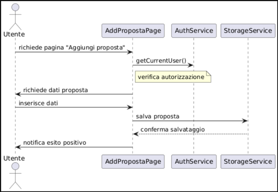 | 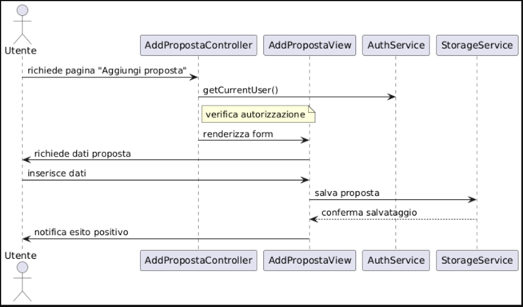 |

<style scoped>
    section { justify-content: center; }
</style>

---

# GRASP Creator, Information Expert, Indirection

Introdotta la classe `PageFactory` la quale ha il compito di centralizzare la creazione dei page‑controller e iniettare le loro dipendenze. 

La sua introduzione è suggerita da:
- **Pattern Creator**
    `PageFactory` è a conoscenze di tutti i servizi/dipendenze di cui un `PageController` potrebbe aver bisogno.
    Di conseguenza, `PageFactory` può essere Creator di `PageController` in quanto *Information Expert*.
- **Pattern Information Expert**
    `PageFactory` essendo a conoscenza di tutte le dipendenze necessarie per creare un `PageController`, è l'Information Expert ideale per questa responsabilità.
    Facendo inoltre *Inversion of Control*, una modifica dei requisiti di creazione di un `PageController` richiede una modifica solo ai `PageController` stessi ed eventualmente la registrazione di nuove dipendenze al boot dell'applicazione.
- **Pattern Indirection**
    `PageFactory` agisce come intermediario tra il `PageRouter` e i `PageController`, riducendo l'accoppiamento diretto tra loro.
    I `PageController` non devono più conoscere i dettagli di creazione delle pagine, ma solo sapere che esistono.

<style scoped>
    p, ul, li, ol { font-size: 0.84em; }
</style>

---

# SOLID Open-Closed Principle: Pre Refactoring
Sintomi di violazione OCP:
- `FattoreDiConversioneHandler` è statica e contiene tutta la logica per la gestione degli FDC in caso di aggiunta/rimozione di un nodo.
Mancano interfacce o altri meccanismi di estensione.
- **Logica hard coded**
Aggiunta o sostituzione di algoritmo comporta modifica del metodo esistente.
Essendo il metodo statico (e globale), sarà obbligatorio intervenire anche su altre classi.


```java
public class FattoreDiConversioneHandler {
    
    public static List<FattoreDiConversione> getFattoriDiConversionToSet(Nodo nodo) {}

    public static List<FattoreDiConversione> getFattoriDiConversionToDelete(Nodo nodo) {}

}
```

<style scoped>
    p, ul, li, ol { font-size: 0.95em; }
</style>

---

# SOLID Open-Closed Principle: Post Refactoring

Risoluzione problema `FattoreDiConversioneHandler` grazie ad introduzione pattern *Strategy*, realizzata tramite interfaccia `FattoreDiConversioneStrategy`.
Di conseguenza:
1. La logica di calcolo dei FDC è stata spostata in questa classe
2. Nei punti dove serviva (es. gestione dell'aggiunta di un nodo) viene iniettata direttamente un'istanza della strategy.
3. Il comportamento diventa open-closed, perché è possibile implementare altre strategy (nuovi algoritmi) senza modificare il codice esistente.

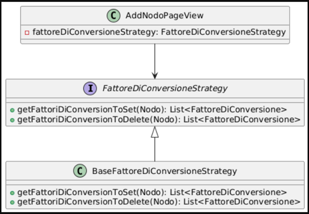

```java
public interface FattoreDiConversioneStrategy {
    List<FattoreDiConversione> getFattoriDiConversionToSet(Nodo nodo);
    List<FattoreDiConversione> getFattoriDiConversionToDelete(Nodo nodo);
}
public class BaseFattoreDiConversioneStrategy implements FattoreDiConversioneStrategy {
    @Override
    public List<FattoreDiConversione> getFattoriDiConversionToSet(Nodo nodo) {}
    @Override
    public List<FattoreDiConversione> getFattoriDiConversionToDelete(Nodo nodo) {}
}
```

<style scoped>
    h1 { margin-bottom: 0; }
    p, ul, li, ol { font-size: 0.8rem; line-height: 1.3; }
    marp-pre { position: absolute; bottom: 90px; left: 490px; width: 55%; font-size: 0.5em; }
</style>

---

# GoF Strategy: Pre e Post refactoring

Come anticipato nelle slides precedenti, lo strumento principale utilizzato per ottenere OCP è stato il pattern *Strategy*.
Il calcolo dei fattori di conversione era implementato in metodi statici della classe `FattoriDiConversioneHandler`,  senza alcuna interfaccia strategica.

| 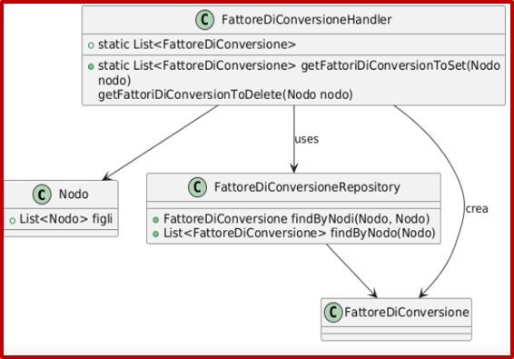 | 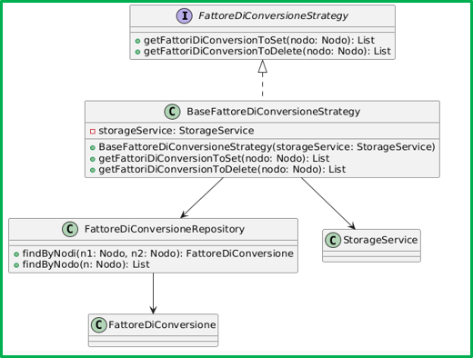 |
|-----------------|------------------|
| L'handler statico richiama direttamente il repository senza alcuna strategia astratta | `BaseFattoreDiConversioneStrategy` incapsula la strategia ed implementa l'interfaccia strategica |

<style scoped>
    h1 { margin-bottom: 0; }
    p { font-size: 0.8em; }
    table { font-size: 0.7em; line-height: 1.2; text-align: center; }
</style>

---

# GoF Strategy: Overview benefici

| Aspetto | Pre-refactoring (Handler statico) | Post-refactoring (Strategy) |
|-----------------|------------------|------------------|
| Organizzazione logica | Algoritmo rigido in metodi statici | Algoritmo incapsulato in Strategy |
| Estendibilità | Modifiche alla classe esistente | Aggiungi nuova strategia, client invariato |
| Principi SOLID | OCP violato | OCP rispettato |
| Dipendenze | Accesso statico a `StorageService` | Dipendenza iniettata via costruttore |

---

# GoF Repository

- `EntityRepository` è un generics che si occupa validare le richieste e svolgere operazioni sulle entità.
- `StorageService` usa un `EntityRepository<T>` per tutte le operazioni sul dominio `T`.
- L'accesso ai dati è quindi mediato da `EntityRepository` (Classe generica).
- `StorageService` permette di ridurre al minimo l'accoppiamento, perché non c'è un legame diretto tra il tipo della repository e quello utilizzato dal client che lo usa.

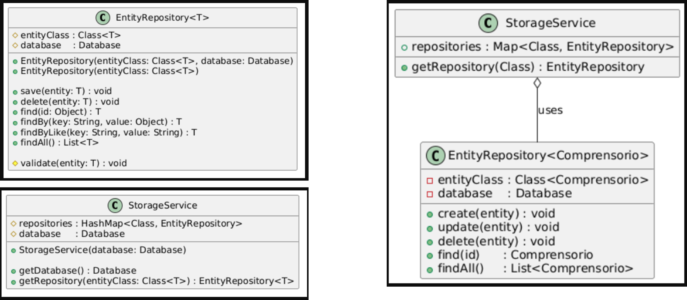

<style scoped>
    h1 { margin-bottom: 0; }
    ul, li { font-size: 0.9em; }
    table { font-size: 0.7em; line-height: 1.2; text-align: center; }
    p { text-align: center; }
</style>

---

# GoF Repository

- Nel post refactoring è stato eliminato il metodo `StorageService.getInstance`; La repository viene ora passata attraverso un’istanza di `StorageService` passata tramite i controller.

    ```java
    this.storageService.getRepository(Comprensorio.class).save(comprensorio);
    ```
    A seguito della chiamata, `ComprensorioRepository.validate` verifica che non esistano duplicati prima di salvare.  

    ```java
        @Override
        protected void validate(Comprensorio entity) {
            super.validate(entity);

            // Verifico che non ci siano comprensori con lo stesso nome
            boolean existsComprensorio = new QComprensorio()
                    .nome.ieq(entity.getNome())
                    .exists();
            if (existsComprensorio) {
                throw new IllegalArgumentException("comprensorio_already_exists");
            }
        }
    ```

<style scoped>
    h1 { margin-bottom: 0; }
    ul, li, ol { font-size: 0.8rem; }
</style>

---

# Testing
###### White Box Testing del metodo `BaseFattoreDiConversioneStrategy.getFattoriDiConversionToSet`

---

## getFattoriDiConversionToSet

```java
public List<FattoreDiConversione> getFattoriDiConversionToSet(Nodo nodo) {
    if (nodo.getFigli().isEmpty()) {
        return new ArrayList<>();
    }

    ArrayList<FattoreDiConversione> fattoriDaAggiungere = new ArrayList<>();
    FattoreDiConversioneRepository fdcRepository =
        (FattoreDiConversioneRepository) this.storageService.getRepository(FattoreDiConversione.class);

    // Aggiungo i fattori di conversione tra le foglie aggiunte
    List<Nodo> foglie = nodo.getFigli().stream().filter(Nodo::isFoglia).toList();
    for (int i = 0; i < foglie.size() - 1; i++) {
        Nodo nodo1 = foglie.get(i);
        Nodo nodo2 = foglie.get(i + 1);
        FattoreDiConversione fdc = fdcRepository.findByNodi(nodo1, nodo2);

        if (fdc != null) { // Se il fattore di conversione esiste già, non lo aggiungo
            continue;
        }

        fattoriDaAggiungere.add(new FattoreDiConversione(nodo1, nodo2));
    }

    // Aggiungo i fattori di conversione in cui parent era incluso
    List<FattoreDiConversione> fdcInCuiParentEraIncluso = fdcRepository.findByNodo(nodo);
    Nodo primoFiglio = nodo.getFigli().getFirst();
    for (FattoreDiConversione fdc : fdcInCuiParentEraIncluso) {
        Nodo destinatario = fdc.getNodo1().equals(nodo) ? fdc.getNodo2() : fdc.getNodo1();
        fattoriDaAggiungere.add(new FattoreDiConversione(primoFiglio, destinatario));
    }

    // Se è una nuova gerarchia, e non è la prima gerarchia, ..
    NodoRepository nodoRepository = (NodoRepository) this.storageService.getRepository(Nodo.class);
    List<Nodo> gerarchie = nodoRepository.findGerarchie().stream()
    .filter(n -> !n.equals(nodo)).toList();
    if (nodo.isRoot() && !gerarchie.isEmpty()) {
        Nodo altraGerarchiaConFoglie = gerarchie.stream().filter(g -> !g.getFoglie().isEmpty()).findFirst().orElse(null);
        if (altraGerarchiaConFoglie != null) {
            Nodo fogliaAltraGerarchia = altraGerarchiaConFoglie.getFigli().stream()
                .filter(Nodo::isFoglia).findFirst().orElse(null);
            Nodo foglia = foglie.stream().findFirst().orElse(null);
            if (fogliaAltraGerarchia != null && foglia != null) {
                fattoriDaAggiungere.add(new FattoreDiConversione(foglia, fogliaAltraGerarchia));
            }
        }
    }

    return fattoriDaAggiungere;
}
```

<style scoped>
    section { padding: 20px; justify-items: center; }
    h2 { width: 100%; padding: 0 60px; margin-left: 80px }
    marp-pre { width: 60%; }
</style>

---

## Obiettivo del metodo testato

Dato un `Nodo`, il metodo `getFattoriDiConversionToSet` si occupa di determinare quali fattori di conversione devono essere creati al fine di mantenere valide le regole della business-logic.

Il metodo viene utilizzato durante l'aggiunta di un nuovo nodo (gerarchia, foglia o categoria).
Il parametro `Nodo` rappresenta il nodo che si sta aggiungendo. 

## Motivo del testing

- Il metodo include un algoritmo di importanza vitale per la logica di business
- L'algoritmo codificato è complesso e non di immediata comprensione

---

## Flow-graph del metodo

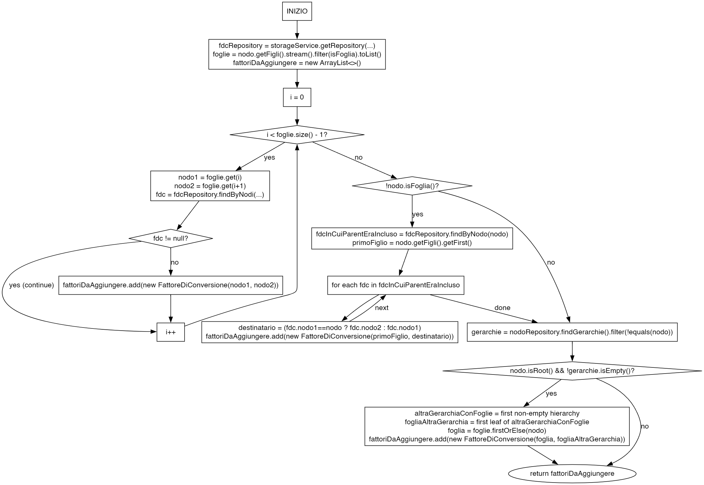

<style scoped>
p { text-align: center; }
section { padding-top: 20px; }
</style>

---

## Calcolo della complessità ciclomatica

La complessità ciclomatica del metodo `getFattoriDiConversionToSet` è **6**, calcolata come segue:
```
COM_CIC = #_PREDICATI + 1
        = 5 + 1
        = 6
```
> Un nodo predicato viene nascosto dalla presenza del foreach (il quale esteso si tramuta in un for, che contiene un predicato)

**Conseguentemente abbiamo 6 cammini indipendenti, che sono stati utilizzati per determinare i test-case.**

---

## Cammino 1

- **Situazione iniziale:** `Nodo` è l'unica gerarchia esistente, senza foglie;
- **Situazione finale:** Nessun fattore di conversione viene creato;

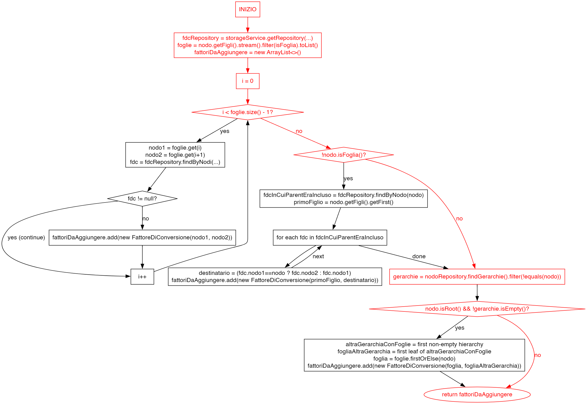

```java
EntityRepository<Nodo> repo =
    storageService.getRepository(Nodo.class);
Nodo root = Nodo.createRoot("Gerarchia 1", null, "attributo_ger1");
repo.save(root);

List<FattoreDiConversione> FDCs = 
    fattoreDiConversioneStrategy.getFattoriDiConversionToSet(root);
Assertions.assertTrue(FDCs.isEmpty());
```


<style scoped>
section { padding: 20px; display: flex; justify-content: flex-start; flex-wrap: wrap; flex-direction: row; align-items: center; }
h2 { width: 100%; padding: 0 60px; }
ul { width: 100%; padding: 0 100px; margin-bottom: 30px; }
p:has(img) { width: 46%; }
marp-pre { width: 50%; }
</style>

---

## Cammino 2

- **Situazione iniziale:** `Nodo` ha almeno 2 foglie, di cui una già esistente, nessuna altra gerarchia presente, ma FDC già esistente tra le foglie;
- **Situazione finale:** Nessun fattore di conversione viene creato;

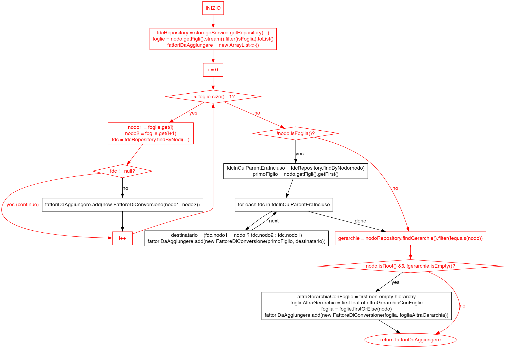

```java
EntityRepository<Nodo> repoNodi = storageService.getRepository(Nodo.class);
EntityRepository<FattoreDiConversione> repoFDC =
    storageService.getRepository(FattoreDiConversione.class);

Nodo root = Nodo.createRoot("Gerarchia 1", null, "attributo_ger1");
repoNodi.save(root);

Nodo foglia1 = Nodo.createFoglia("Foglia1", null, "attributo", root);
Nodo foglia2 = Nodo.createFoglia("Foglia2", null, "attributo2", root);
repoNodi.save(foglia1);
repoNodi.save(foglia2);

FattoreDiConversione fdc = new FattoreDiConversione(foglia1, foglia2, 1.0);
repoFDC.save(fdc);

root = repoNodi.find(root.getId());
List<FattoreDiConversione> FDCs = 
    fattoreDiConversioneStrategy.getFattoriDiConversionToSet(root);
Assertions.assertTrue(FDCs.isEmpty());
```


<style scoped>
section { padding: 20px; display: flex; justify-content: flex-start; flex-wrap: wrap; flex-direction: row; align-items: center; }
h2 { width: 100%; padding: 0 60px; }
ul { width: 100%; padding: 0 100px; margin-bottom: 30px; }
p:has(img) { width: 46%; }
marp-pre { width: 50%; }
</style>

---

## Cammino 3

- **Situazione iniziale:** `Nodo` ha almeno 2 foglie, di cui una già esistente, nessuna altra gerarchia presente, FDC **non esistente** tra le foglie;
- **Situazione finale:** Viene creato un fattore di conversione tra le due foglie;

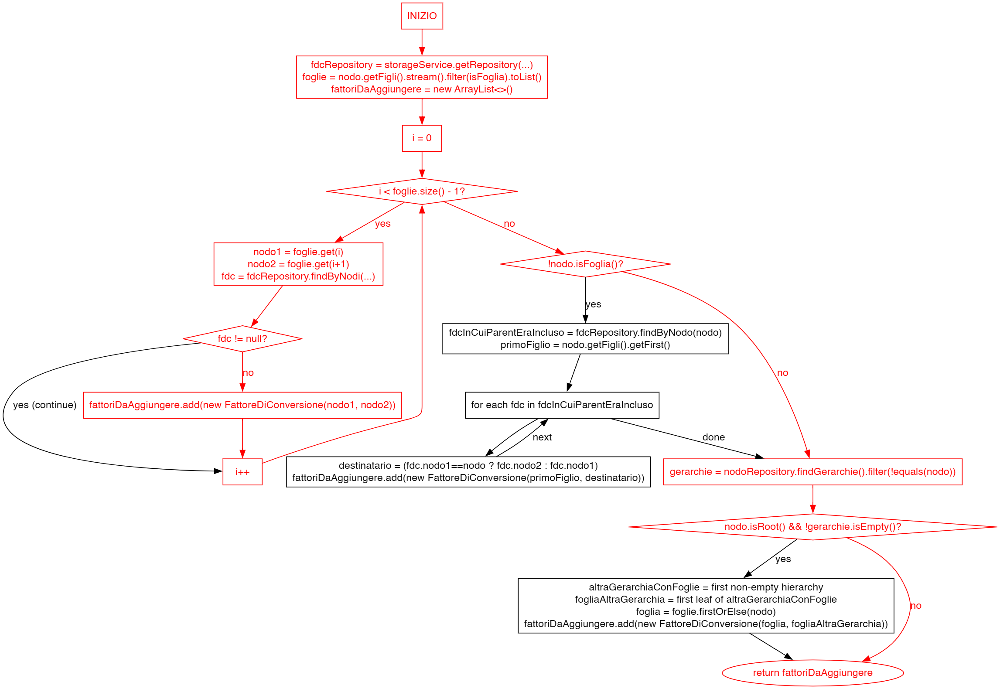

```java
EntityRepository<Nodo> repoNodi =
    storageService.getRepository(Nodo.class);

Nodo root = Nodo.createRoot("Gerarchia 1", null, "attributo_ger1");
repoNodi.save(root);

Nodo foglia1 = Nodo.createFoglia("Foglia1", null, "attributo", root);
Nodo foglia2 = Nodo.createFoglia("Foglia2", null, "attributo2", root);
repoNodi.save(foglia1);
repoNodi.save(foglia2);

FattoreDiConversione expectedFDC =
    new FattoreDiConversione(foglia1, foglia2, 1.0);

root = repoNodi.find(root.getId());
List<FattoreDiConversione> FDCs =
    fattoreDiConversioneStrategy.getFattoriDiConversionToSet(root);
List<FattoreDiConversione> expectedFDCs = List.of(expectedFDC);
Assertions.assertEquals(expectedFDCs.size(), FDCs.size());
```


<style scoped>
section { padding: 20px; display: flex; justify-content: flex-start; flex-wrap: wrap; flex-direction: row; align-items: center; }
h2 { width: 100%; padding: 0 60px; }
ul { width: 100%; padding: 0 100px; margin-bottom: 30px; }
p:has(img) { width: 46%; }
marp-pre { width: 50%; }
</style>

---

## Cammino 4

- **Situazione iniziale:** `Nodo` ha non più di 1 foglia, nessuna altra gerarchia presente;
- **Situazione finale:** Non viene creato alcun fattore di conversione;

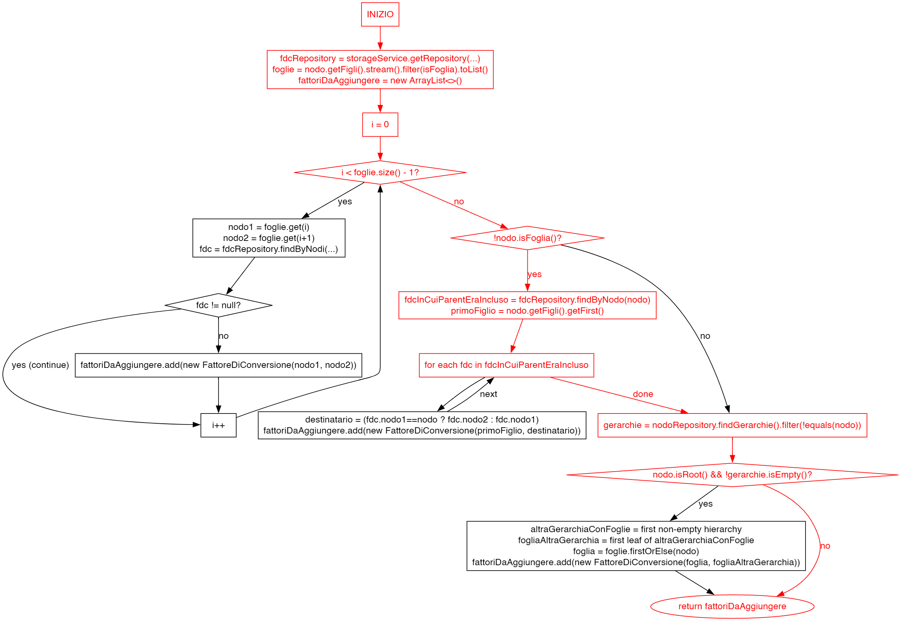

```java
EntityRepository<Nodo> repoNodi = storageService.getRepository(Nodo.class);

Nodo root = Nodo.createRoot("Gerarchia 1", null, "attributo_ger1");
repoNodi.save(root);

Nodo foglia = Nodo.createFoglia("NonRadice", null, "attributo", root);
repoNodi.save(foglia);

root = repoNodi.find(root.getId());
List<FattoreDiConversione> FDCs =
    fattoreDiConversioneStrategy.getFattoriDiConversionToSet(root);
Assertions.assertTrue(FDCs.isEmpty());
```

<style scoped>
section { padding: 20px; display: flex; justify-content: flex-start; flex-wrap: wrap; flex-direction: row; align-items: center; }
h2 { width: 100%; padding: 0 60px; }
ul { width: 100%; padding: 0 100px; margin-bottom: 30px; }
p:has(img) { width: 46%; }
marp-pre { width: 50%; }
</style>

---

## Cammino 5

- **Situazione iniziale:** Ex-foglia diventa categoria con una sola foglia, nessuna altra gerarchia presente;
- **Situazione finale:** Viene creato un fattore di conversione tra la foglia e il nodo a cui era precedentemente collegato `Nodo`;

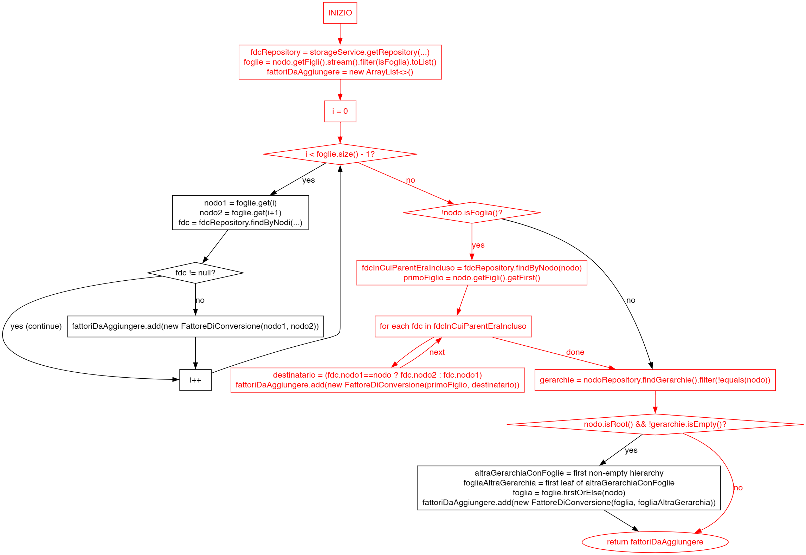

```java
EntityRepository<Nodo> repoNodi = storageService.getRepository(Nodo.class);
EntityRepository<FattoreDiConversione> repoFDC = 
    storageService.getRepository(FattoreDiConversione.class);

Nodo root = Nodo.createRoot("Gerarchia 1", null, "attributo_ger1");
repoNodi.save(root);

Nodo foglia1 = Nodo.createFoglia("N1", null, "attributo", root);
Nodo exFoglia2 = Nodo.createFoglia("N2", null, "attributo2", root);
repoNodi.save(foglia1);
repoNodi.save(exFoglia2);

FattoreDiConversione fdc =
    new FattoreDiConversione(foglia1, exFoglia2, 1.0);
repoFDC.save(fdc);

Nodo nuovaFoglia = Nodo.createFoglia("N1.1", null, "attributo3", exFoglia2);
repoNodi.save(nuovaFoglia);

FattoreDiConversione expectedFDC = 
    new FattoreDiConversione(foglia1, nuovaFoglia, 1.0);

exFoglia2 = repoNodi.find(exFoglia2.getId());
List<FattoreDiConversione> FDCs =
    fattoreDiConversioneStrategy.getFattoriDiConversionToSet(exFoglia2);
List<FattoreDiConversione> expectedFDCs = List.of(expectedFDC);
Assertions.assertEquals(expectedFDCs.size(), FDCs.size());
```


<style scoped>
section { padding: 20px; display: flex; justify-content: flex-start; flex-wrap: wrap; flex-direction: row; align-items: center; }
h2 { width: 100%; padding: 0 60px; }
ul { width: 100%; padding: 0 100px; margin-bottom: 30px; line-height: 1.3; }
p:has(img) { width: 46%; }
marp-pre { width: 50%; font-size: 0.42em; }
</style>

---

## Cammino 6

- **Situazione iniziale:** Nuova gerarchia aggiunta ed esiste altra gerarchia con foglie;
- **Situazione finale:** Viene creato un fattore di conversione tra la nuova gerarchia e una foglia dell'altra gerarchia;

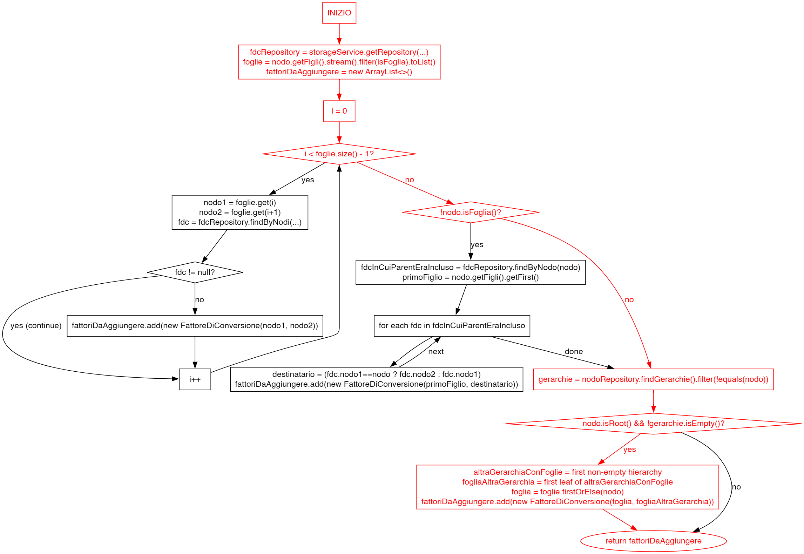

```java
EntityRepository<Nodo> repoNodi = storageService.getRepository(Nodo.class);
EntityRepository<FattoreDiConversione> repoFDC =
    storageService.getRepository(FattoreDiConversione.class);

Nodo root = Nodo.createRoot("Gerarchia 1", null, "attributo_ger1");
repoNodi.save(root);

Nodo foglia1 = Nodo.createFoglia("Foglia1", null, "attributo", root);
repoNodi.save(foglia1);

Nodo nuovaGerarchia = Nodo.createRoot("Gerarchia 2", null, "attributo3");
repoNodi.save(nuovaGerarchia);

FattoreDiConversione fdc =
    new FattoreDiConversione(foglia1, nuovaGerarchia, 1.0);
repoFDC.save(fdc);

nuovaGerarchia = repoNodi.find(nuovaGerarchia.getId());
List<FattoreDiConversione> FDCs =
    fattoreDiConversioneStrategy.getFattoriDiConversionToSet(nuovaGerarchia);
List<FattoreDiConversione> expectedFDCs = List.of(fdc);
Assertions.assertEquals(expectedFDCs.size(), FDCs.size());
```


<style scoped>
section { padding: 20px; display: flex; justify-content: flex-start; flex-wrap: wrap; flex-direction: row; align-items: center; }
h2 { width: 100%; padding: 0 60px; }
ul { width: 100%; padding: 0 100px; margin-bottom: 30px; }
p:has(img) { width: 46%; }
marp-pre { width: 50%; font-size: 0.48em; }
</style>

---

# Refactoring
###### Refactoring tramite pattern `Extract Method` del metodo `BaseFattoreDiConversioneStrategy.getFattoriDiConversionToSet`

---

## Il metodo candidato al refactoring

Il metodo `getFattoriDiConversionToSet` è risultato essere un ottimo candidato a essere rifattorizzato in quanto:
- È eccessivamente lungo
- Contiene un algoritmo separato logicamente in 3 parti distinte (violazione del principio SRP)

La sua rifattorizzazione è stata effettuata tramite il pattern `Extract Method`, creando 3 metodi privati che si occupano di calcolare i fattori di conversione in modo specifico:
- `calcolaFattoriTraFoglie`: calcola i fattori di conversione tra le foglie dello stesso livello
- `calcolaFattoriConParentIncluso`: calcola i fattori di conversione in cui il parent era incluso in modo da avere fdc solo tra nodi foglie
- `calcolaFattoriTraGerarchie`: calcola i fattori di conversione che permettono di collegare gerarchie diverse

<style scoped>
    p, ul { font-size: 0.9em; }
</style>

---

#### Il nuovo metodo `getFattoriDiConversionToSet`
```java
public List<FattoreDiConversione> getFattoriDiConversionToSet(Nodo nodo) {
    FattoreDiConversioneRepository fdcRepository = (FattoreDiConversioneRepository) 
        this.storageService.getRepository(FattoreDiConversione.class);
    List<Nodo> foglie = nodo.getFigli().stream().filter(Nodo::isFoglia).toList();
    ArrayList<FattoreDiConversione> fattoriDaAggiungere = new ArrayList<>();

    fattoriDaAggiungere.addAll(this.calcolaFattoriTraFoglie(foglie, fdcRepository));
    fattoriDaAggiungere.addAll(this.calcolaFattoriConParentIncluso(nodo, fdcRepository));

    FattoreDiConversione fdcInterGerarchie = this.calcolaFattoriTraGerarchie(nodo, foglie);
    if (fdcInterGerarchie != null) {
        fattoriDaAggiungere.add(fdcInterGerarchie);
    }

    return fattoriDaAggiungere;
}
```
---

#### Subroutine 1: `calcolaFattoriTraFoglie`
<small>Subroutine per calcolare i fattori di conversione tra foglie allo stesso livello</small>

```java
private List<FattoreDiConversione> calcolaFattoriTraFoglie(List<Nodo> foglie, FattoreDiConversioneRepository fdcRepository) {
    List<FattoreDiConversione> fattoriDaAggiungere = new ArrayList<>();
    for (int i = 0; i < foglie.size() - 1; i++) {
        Nodo nodo1 = foglie.get(i);
        Nodo nodo2 = foglie.get(i + 1);
        FattoreDiConversione fdc = fdcRepository.findByNodi(nodo1, nodo2);

        if (fdc != null) { // Se il fattore di conversione esiste già, non lo aggiungo
            continue;
        }

        fattoriDaAggiungere.add(new FattoreDiConversione(nodo1, nodo2));
    }
    return fattoriDaAggiungere;
}
```

---

#### Subroutine 2: `calcolaFattoriConParentIncluso`
<small>Subroutine per calcolare i fattori di conversione in cui parent era incluso</small>

```java
private List<FattoreDiConversione> calcolaFattoriConParentIncluso(Nodo nodo, 
    FattoreDiConversioneRepository fdcRepository) {
    if (nodo.isFoglia()) {
        return List.of();
    }

    ArrayList<FattoreDiConversione> fattoriDaAggiungere = new ArrayList<>();
    List<FattoreDiConversione> fdcInCuiParentEraIncluso = fdcRepository.findByNodo(nodo);
    Nodo primoFiglio = nodo.getFigli().getFirst();
    for (FattoreDiConversione fdc : fdcInCuiParentEraIncluso) {
        Nodo destinatario = fdc.getNodo1().equals(nodo) ? fdc.getNodo2() : fdc.getNodo1();
        fattoriDaAggiungere.add(new FattoreDiConversione(primoFiglio, destinatario));
    }
    return fattoriDaAggiungere;
}
```

---

#### Subroutine 3: `calcolaFattoriTraGerarchie`
<small>Subroutine per calcolare i fattori di conversione inter-gerarchia</small>

```java
private FattoreDiConversione calcolaFattoriTraGerarchie(Nodo nodo, List<Nodo> foglie) {
    NodoRepository nodoRepository = (NodoRepository) this.storageService.getRepository(Nodo.class);
    List<Nodo> gerarchie = nodoRepository.findGerarchie().stream()
        .filter(n -> !n.equals(nodo))
        .toList();

    if (!nodo.isRoot() || gerarchie.isEmpty()) {
        return null;
    }

    Nodo altraGerarchiaConFoglie = gerarchie.stream()
            .filter(g -> !g.getFoglie().isEmpty() || g.isFoglia())
            .findFirst()
            .orElseThrow(() -> new IllegalStateException("Sono presenti gerarchie diverse da quella attuale senza foglie"));

    Nodo fogliaAltraGerarchia = altraGerarchiaConFoglie.getFigli().stream()
            .filter(Nodo::isFoglia)
            .findFirst()
            .orElse(altraGerarchiaConFoglie);

    Nodo foglia = foglie.stream().findFirst().orElse(nodo);
    return new FattoreDiConversione(foglia, fogliaAltraGerarchia);
}
```
